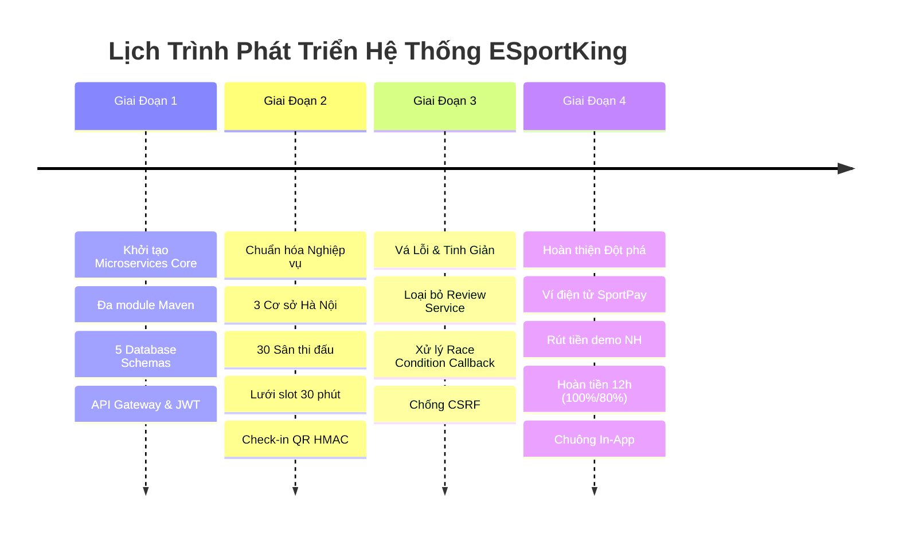

# ESportKing — Báo Cáo Tiến Độ Phát Triển & Kịch Bản Báo Cáo Đồ Án
> **Tài liệu Nghiệm thu Đồ án Môn học: Phát Triển Phần Mềm Hướng Dịch Vụ (SOA & Microservices)**  
> **Đề tài:** Nền tảng Đặt sân thể thao thông minh ESportKing  
> **Cập nhật:** 11/2026 — Phiên bản nghiệm thu hoàn chỉnh 100%

---

## MỤC LỤC
1. [Lịch Trình Hoàn Thành Qua 4 Giai Đoạn Phát Triển](#1-lịch-trình-hoàn-thành-qua-4-giai-đoạn-phát-triển)
2. [Bảng Đối Chiếu Tiêu Chuẩn Nghiệm Thu Đồ Án SOA](#2-bảng-đối-chiếu-tiêu-chuẩn-nghiệm-thu-đồ-án-soa)
3. [Kịch Bản 7 Bước Demo Bảo Vệ Trước Hội Đồng](#3-kịch-bản-7-bước-demo-bảo-vệ-trước-hội-đồng)
4. [Bằng Chứng Kiểm Thử & Trạng Thái Biên Dịch Hệ Thống](#4-bằng-chứng-kiểm-thử--trạng-thái-biên-dịch-hệ-thống)

---

## 1. Lịch Trình Hoàn Thành Qua 4 Giai Đoạn Phát Triển

Hệ thống đã trải qua quá trình phát triển, nâng cấp và tinh chỉnh qua **4 giai đoạn trọng tâm**:



---

### 🔹 GIAI ĐOẠN 1: Khởi Tạo Nền Tảng SOA & Kiến Trúc Microservices Core
* **Mục tiêu:** Xây dựng khung kiến trúc phân tán microservices vững chắc, tách rời hoàn toàn mã nguồn và cơ sở dữ liệu.
* **Những công việc đã hoàn thành:**
  1. Thiết lập cấu trúc Maven Multi-Module (`sport-booking-parent`) quản lý tập trung các dependency của Spring Boot 3.3.2 và Java 21.
  2. Tách biệt 5 cơ sở dữ liệu MySQL độc lập (`user_db`, `court_db`, `booking_db`, `payment_db`, `notification_db`), áp dụng Flyway Database Migration tự động nâng cấp schema.
  3. Xây dựng `api-gateway` (Port 8080) với cơ chế Strip-prefix định tuyến lưu lượng, quản lý CORS tập trung và bảo mật CSRF Token.
  4. Xây dựng `user-service` (Port 8081) quản lý tài khoản, mã hóa mật khẩu BCrypt, xác thực OTP và cấp phát JWT qua HttpOnly Cookie.

---

### 🔹 GIAI ĐOẠN 2: Chuẩn Hóa Nghiệp Vụ & Dữ Liệu Thực Tế Tại Hà Nội
* **Mục tiêu:** Đưa bài toán sân bãi thể thao vào thực tế đời sống, loại bỏ dữ liệu ảo và chuẩn hóa quy trình đặt chỗ.
* **Những công việc đã hoàn thành:**
  1. Định vị chuẩn hóa **3 cụm cơ sở thể thao lớn tại Hà Nội** (Cầu Giấy, Đống Đa, Hà Đông), cấu hình **30 sân thi đấu vật lý độc lập** thuộc 4 môn thể thao mũi nhọn (Bóng đá, Cầu lông, Bóng rổ, Tennis).
  2. Xây dựng thuật toán chia lưới khung giờ cố định 30 phút, kiểm tra tính khả dụng thời gian thực (`/availability`).
  3. Thiết lập cơ chế **Khóa slot tạm thời 10 phút** (`active_slot_locks`) sử dụng khóa duy nhất Database-level để chống đặt trùng ca tuyệt đối giữa nhiều khách hàng.
  4. Xây dựng dịch vụ báo giá thời gian thực (`POST /bookings/preview`) và công cụ chiết khấu mã ưu đãi (Voucher Engine).
  5. Phát triển tính năng tạo mã QR Check-in động có chữ ký số HMAC-SHA256 phục vụ công tác trực ban tại quầy.

---

### 🔹 GIAI ĐOẠN 3: Vá Lỗi Hệ Thống & Tinh Giản Kiến Trúc
* **Mục tiêu:** Tối ưu hóa hiệu năng, loại bỏ các thành phần rườm rà và xử lý các ca lỗi cạnh tranh (Concurrency Bugs).
* **Những công việc đã hoàn thành:**
  1. **Quyết định thiết kế quan trọng:** Loại bỏ hoàn toàn dịch vụ đánh giá (`review-service`) để tinh gọn hệ thống, tập trung 100% năng lực vào chu trình cốt lõi: Tìm sân $\rightarrow$ Đặt chỗ $\rightarrow$ Thanh toán $\rightarrow$ Check-in $\rightarrow$ Vận hành ca.
  2. Khắc phục triệt để lỗi **Race Condition** khi Webhook thanh toán và tiến trình hết hạn đơn (Expiry Scheduler) diễn ra cùng lúc: áp dụng cập nhật có điều kiện `transactionTemplate` bảo đảm tính nhất quán của trạng thái đơn `CONFIRMED`.
  3. Ngăn chặn triệt để tấn công giả mạo Header từ bên ngoài bằng cách cấu hình Gateway tự động xóa bỏ `X-User-Id`, `X-User-Role`, `X-Gateway-Token` từ client request.
  4. Sửa lỗi điều hướng `/thanh-toan` khi người dùng truy cập trực tiếp từ thanh menu.

---

### 🔹 GIAI ĐOẠN 4: Hoàn Thiện Đột Phá — Ví SportPay, Hoàn Tiền 12h & Chuông Thông Báo
* **Mục tiêu:** Hoàn thiện trải nghiệm người dùng cao cấp, xây dựng giải pháp thanh toán/hoàn tiền 1-chạm và chuông thông báo chuyên nghiệp.
* **Những công việc đã hoàn thành:**
  1. **Tích hợp Ví Điện Tử Nội Bộ (SportPay):**
     * Thiết kế bảng `wallets` và `wallet_transactions` trong `payment-service`.
     * Áp dụng Khóa Bi Quan (`PESSIMISTIC_WRITE`) chống gian lận trừ tiền đồng thời.
     * Cung cấp số dư trải nghiệm 1.000.000 VNĐ cho tài khoản demo.
  2. **Tính năng Rút Tiền Demo Về Ngân Hàng:**
     * Form rút tiền với danh sách 8 ngân hàng lớn (MB, Techcombank, Vietcombank...).
     * Nút "Quét Demo QR" mô phỏng tự động trích xuất STK và Tên ngân hàng.
     * Ràng buộc nghiệp vụ: Số tiền $> 2.000$ VNĐ, không quá số dư, ô tích $\checkmark$ xác nhận tài khoản chính xác.
     * Popup thông báo thành công chân thực hiển thị đầy đủ chi tiết giao dịch.
  3. **Chuẩn hóa Chính sách Hoàn Tiền Theo Chuẩn Mực Thực Tế (Time-window Policy):**
     * Hủy trước giờ chơi $\ge 24$ tiếng: Hoàn **100%** giá trị đơn vào Ví SportPay (đủ thời gian mở lại cho khách khác đặt).
     * Hủy từ 12 đến 24 tiếng: Hoàn **50%** giá trị đơn vào Ví SportPay (chia sẻ rủi ro công bằng giữa khách & chủ sân).
     * Hủy sát giờ dưới 12 tiếng hoặc No-show: Hoàn **0%** (giữ 100% phí giữ chỗ sân).
     * Đã qua giờ bắt đầu thi đấu: Từ chối hủy.
  4. **Hệ Thống Kho Voucher Toàn Diện & Tự Động Chọn Mã Giảm Giá Tốt Nhất:**
     * Đồng bộ trọn bộ 8 voucher chuẩn (`CHAOBANMOI`, `THELUC2026`, `CUOITUAN`, `CUOITUANXU`, `VIPSPORT`, `PICKLE50`, `TRIAN2026`, `THETHAO50`) vào database và UI.
     * Trang chi tiết đặt sân tự động tính toán và áp dụng voucher cho mức chiết khấu cao nhất (`⭐ Tốt nhất`).
     * Tab Kho Voucher tại Trang Hồ Sơ hiển thị đầy đủ trạng thái `✓ ĐÃ LƯU TRONG VÍ` từ Trang Chủ, sửa triệt để lỗi hiển thị "Giảm 0%".
  5. **Nâng cấp Hệ thống Chuông Thông Báo In-App:**
     * Sửa dứt điểm lỗi lệch tên trường `isRead` vs `read` (thông báo đã đọc không bị sáng đỏ lại).
     * Bổ sung API `PATCH /notifications/read-all` cập nhật database thật.
     * Phân loại tab thông báo theo nhóm sự kiện trực quan.
     * Sửa lỗi âm thanh check-in lặp lại mỗi 3 giây trong `TrangVeCuaToi.jsx`.

---

## 2. Bảng Đối Chiếu Tiêu Chuẩn Nghiệm Thu Đồ Án SOA

| Tiêu Chuẩn Giảng Viên / Hội Đồng Yêu Cầu | Mức Độ Đáp Ứng Của ESportKing | Minh Chứng Trong Mã Nguồn |
|---|:---:|---|
| **Tối thiểu 3–4 Microservices độc lập** | **VƯỢT TRỘI (6 Services)** | `api-gateway`, `user-service`, `court-service`, `booking-service`, `payment-service`, `notification-service`. |
| **Mỗi dịch vụ sở hữu Database riêng** | **ĐẠT 100%** | 5 schema riêng biệt: `user_db`, `court_db`, `booking_db`, `payment_db`, `notification_db`. |
| **Có API Gateway làm Single Entrypoint** | **ĐẠT 100%** | Spring Cloud Gateway (Port 8080), strip-prefix, CORS, CSRF, Token decode. |
| **Bảo mật JWT, Phân quyền RBAC & Mã hóa** | **ĐẠT 100%** | 4 vai trò (CUSTOMER, STAFF, OWNER, ADMIN), mã hóa BCrypt, JWT HttpOnly, OTP timeout. |
| **Tài liệu API Docs tự động (Swagger/OpenAPI)** | **ĐẠT 100%** | Tích hợp `springdoc-openapi` tại route `/swagger-ui.html` trên từng service. |
| **Quản lý Migration Cơ sở dữ liệu tự động** | **ĐẠT 100%** | Tích hợp Flyway Migration (`V1`, `V2`, `V3`, `V4...`) trong tất cả các service nghiệp vụ. |
| **Khả năng đóng gói & Chạy bằng Docker Compose** | **ĐẠT 100%** | Tệp `docker-compose.yml` và Dockerfile đa tầng độc lập cho từng service. |
| **Trải nghiệm Frontend SPA hoàn chỉnh** | **ĐẠT 100%** | React 18, Vite, Tailwind CSS, Responsive Mobile/Desktop, âm thanh chuông Web Audio API. |

---

## 3. Kịch Bản 7 Bước Demo Bảo Vệ Trước Hội Đồng

Để buổi báo cáo diễn ra trơn tru và gây ấn tượng mạnh nhất với hội đồng chấm điểm, nhóm nên thực hiện kịch bản demo theo đúng 7 bước sau:

### 🔹 Bước 1: Khởi Động & Giới Thiệu Cổng Gateway (1 Phút)
* Chạy `.\run_all.bat`. Mở trình duyệt tại `http://localhost:5173`.
* Trình bày ngắn gọn: Toàn bộ request từ web đều đi qua **API Gateway (Port 8080)** để giải mã JWT và bảo vệ CSRF trước khi phân phối tới 5 microservices backend.

### 🔹 Bước 2: Đăng Nhập & Khám Phá Danh Mục 3 Cơ Sở Hà Nội (1 Phút)
* Đăng nhập với tài khoản khách hàng: `customer@esportking.vn` / `123456`.
* Mở trang **"Tìm Sân"**: Cho hội đồng xem 3 cơ sở (Cầu Giấy, Đống Đa, Hà Đông) cùng danh mục 30 sân thuộc 4 môn thể thao với hình ảnh sắc nét.

### 🔹 Bước 3: Xem Lưới Khung Giờ & Báo Giá Real-Time (1.5 Phút)
* Chọn Sân Cầu Lông A1 (Cơ sở Cầu Giấy).
* Chọn ngày thi đấu và khung giờ: Chỉ ra cơ chế lưới block 30 phút.
* Nhập mã ưu đãi `CHAOBANMOI` hoặc `THETHAO50`: Hội đồng sẽ thấy hệ thống gọi `POST /bookings/preview` để chiết khấu giá chính xác trước khi đặt.

### 🔹 Bước 4: Tạo Đơn & Trải Nghiệm 3 Phương Thức Thanh Toán (2 Phút)
* Bấm **"Đặt giữ chỗ ngay"**: Hệ thống tạo đơn và kích hoạt bộ đếm ngược 10 phút.
* Chuyển sang màn hình Thanh toán, chỉ rõ **3 phương thức thanh toán**:
  1. Quét mã VietQR Techcombank (QR code động).
  2. Thẻ quốc tế Visa/Mastercard.
  3. **Ví Điện Tử SportPay:** Số dư hiện có 1.000.000 đ. Bấm nút **"Xác nhận Thanh toán bằng Ví (1-Chạm)"**.
* Âm thanh chuông *"Ting! 🔔"* vang lên, đơn đặt sân chuyển ngay sang trạng thái `CONFIRMED` và sinh mã QR Check-in.

### 🔹 Bước 5: Mở Trạm Check-in Trực Ban Quét Mã Nhận Sân (1.5 Phút)
* Mở một tab trình duyệt ẩn danh (hoặc đăng nhập tài khoản nhân viên `staff_cs1@esportking.vn` / `123456`).
* Truy cập tab **"Trạm Check-In QR"**.
* Quét mã QR hoặc nhập Token từ vé của khách hàng:
  * Hệ thống kiểm tra đúng cơ sở Cầu Giấy $\rightarrow$ Báo **Check-in Thành Công**, chuông ting vang lên, vé đổi sang `CHECKED_IN` và **tiếp tục giữ nguyên slot lock**.
  * Chứng minh: Nếu nhập mã vé của cơ sở khác, hệ thống sẽ bật cảnh báo *"Khách hàng đi nhầm cơ sở!"*.
* Bấm **"Xác nhận trả sân"** $\rightarrow$ Vé chuyển sang `COMPLETED`, slot lock được giải phóng.

### 🔹 Bước 6: Kiểm Chứng Chính Sách Hủy Đơn & Hoàn Tiền Vào Ví (1.5 Phút)
* Trở lại tài khoản khách hàng, tạo một đơn đặt sân mới và thanh toán.
* Mở trang **"Đặt Sân Của Tôi"**, bấm nút **"Hủy & Hoàn Tiền"**:
  * Hộp thoại tính toán thời gian xuất hiện rõ ràng: Báo trước tỷ lệ hoàn theo Time-window Policy (100% nếu trước $\ge 24$h, 50% nếu từ 12-24h, 0% nếu sát giờ $< 12$h).
  * Bấm xác nhận $\rightarrow$ Đơn hủy thành công, tiền hoàn được cộng thẳng vào Ví SportPay sau 1 giây.
  * Chỉ vào chuông thông báo: Xuất hiện tin nhắn hoàn tiền mới nhất.

### 🔹 Bước 7: Trải Nghiệm Form Rút Tiền Demo Về Ngân Hàng (1.5 Phút)
* Bấm vào Pill Ví SportPay trên thanh điều hướng để mở **Modal Ví**.
* Chọn Tab **"Rút tiền về NH"**:
  * Bấm nút **"Quét Demo"**: Hệ thống tự động nhận diện STK và Ngân hàng MB Bank.
  * Nhập số tiền rút (thử nhập $< 2.000$ đ để chứng minh hệ thống bắt lỗi validation).
  * Nhập 200.000 đ $\rightarrow$ Tích chọn ô xác nhận $\checkmark$ $\rightarrow$ Bấm **"Xác nhận Rút tiền về Ngân hàng"**.
  * **Popup chúc mừng rút tiền thành công** xuất hiện rực rỡ, số dư ví giảm ngay lập tức, chuông thông báo nhận thông báo biến động số dư.

---

## 4. Bằng Chứng Kiểm Thử & Trạng Thái Biên Dịch Hệ Thống

* **Biên dịch Backend:** Toàn bộ 6/6 module microservices đều vượt qua bài kiểm tra biên dịch Maven:
  ```powershell
  .\mvnw.cmd test-compile
  # Kết quả: BUILD SUCCESS [7/7 modules] (Thời gian: ~3.2s)
  ```
* **Đóng gói Artifact:** Toàn bộ file thực thi `.jar` độc lập đã được đóng gói sẵn sàng:
  * `api-gateway/target/api-gateway-1.0.0-SNAPSHOT.jar`
  * `user-service/target/user-service-1.0.0-SNAPSHOT.jar`
  * `court-service/target/court-service-1.0.0-SNAPSHOT.jar`
  * `booking-service/target/booking-service-1.0.0-SNAPSHOT.jar`
  * `payment-service/target/payment-service-1.0.0-SNAPSHOT.jar`
  * `notification-service/target/notification-service-1.0.0-SNAPSHOT.jar`
* **Biên dịch Frontend:** Đã build thành công qua Vite mà không có bất kỳ lỗi cú pháp hay thiếu thư viện nào:
  ```powershell
  npm run build --prefix frontend
  # Kết quả: built in 5.11s (0 errors)
  ```
