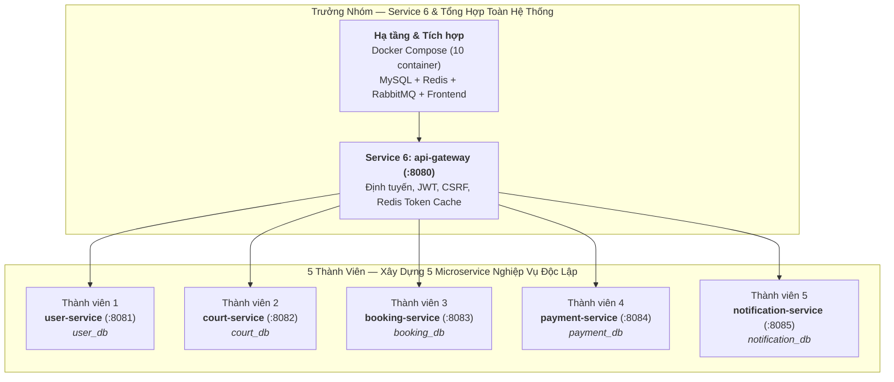

# ESportKing — Cấu Trúc Chương Trình & Phân Công Nhóm (5 Thành Viên + Trưởng Nhóm)
> **Tài liệu Tổ chức Mã nguồn & Phân chia Trách nhiệm Đồ án Môn: Phát Triển Phần Mềm Hướng Dịch Vụ (SOA & Microservices)**  
> **Mô hình phân công:** 5 Thành viên phụ trách độc lập 5 Microservice nghiệp vụ → **Trưởng nhóm** phát triển **Service thứ 6 (`api-gateway`)** và tổng hợp, tích hợp toàn hệ thống (Docker, Hạ tầng, Frontend).  
> **Cập nhật:** 25/11/2026 (Phiên bản v2.1)

---

## MỤC LỤC
1. [Tổng Quan Cấu Trúc Thư Mục Chương Trình](#1-tổng-quan-cấu-trúc-thư-mục-chương-trình)
2. [Sơ Đồ Phân Công & Tích Hợp Về Service 6 (Trưởng Nhóm)](#2-sơ-đồ-phân-công--tích-hợp-về-service-6-trưởng-nhóm)
3. [Bảng Phân Công Chi Tiết 5 Thành Viên & Trưởng Nhóm](#3-bảng-phân-công-chi-tiết-5-thành-viên--trưởng-nhóm)
4. [Chi Tiết Cấu Trúc & Nhiệm Vụ Từng Service](#4-chi-tiết-cấu-trúc--nhiệm-vụ-từng-service)
   - [Thành viên 1 — `user-service` (Service 1)](#41-thành-viên-1--user-service-service-1--port-8081)
   - [Thành viên 2 — `court-service` (Service 2)](#42-thành-viên-2--court-service-service-2--port-8082)
   - [Thành viên 3 — `booking-service` (Service 3)](#43-thành-viên-3--booking-service-service-3--port-8083)
   - [Thành viên 4 — `payment-service` (Service 4)](#44-thành-viên-4--payment-service-service-4--port-8084)
   - [Thành viên 5 — `notification-service` (Service 5)](#45-thành-viên-5--notification-service-service-5--port-8085)
   - [Trưởng nhóm — `api-gateway` (Service 6) & Tổng Hợp Hệ Thống](#46-trưởng-nhóm--api-gateway-service-6--port-8080--tổng-hợp-hệ-thống)
5. [Quy Trình Ghép Nối & Hợp Nhất Code Về Nhóm Trưởng](#5-quy-trình-ghép-nối--hợp-nhất-code-về-nhóm-trưởng)

---

## 1. Tổng Quan Cấu Trúc Thư Mục Chương Trình

Dự án được tổ chức theo mô hình **Maven Multi-Module (`sport-booking-parent`)** cho 6 dịch vụ Java Spring Boot 3.3.2 (Java 21) kết hợp 1 ứng dụng SPA **React 18 + Vite** và bộ điều phối **Docker Compose (10 container)**:

```text
Đồ Án Môn Phát Triển Phần Mềm Hướng DV/
├── pom.xml                                # Parent POM quản lý tập trung 6 module backend
├── docker-compose.yml                     # Điều phối 10 container (MySQL, Redis, RabbitMQ, 6 services, Frontend)
├── docker/mysql/init.sql                  # Khởi tạo tự động 5 schema DB riêng biệt + user sport_user
├── run_all.bat                            # Script khởi động 1-click toàn hệ thống trên Windows
├── reset_demo_data.bat                    # Script làm sạch dữ liệu demo trước khi bảo vệ
├── .env / .env.example                    # Biến môi trường (DB, JWT, SMTP, Gemini AI, Internal API Key)
│
├── user-service/                          # [Service 1 - TV1] Port 8081 | Schema: user_db
├── court-service/                         # [Service 2 - TV2] Port 8082 | Schema: court_db
├── booking-service/                       # [Service 3 - TV3] Port 8083 | Schema: booking_db
├── payment-service/                       # [Service 4 - TV4] Port 8084 | Schema: payment_db
├── notification-service/                  # [Service 5 - TV5] Port 8085 | Schema: notification_db
├── api-gateway/                           # [Service 6 - Trưởng nhóm] Port 8080 | Gateway & Bảo mật
│
├── frontend/                              # [Trưởng nhóm tổng hợp UI] React 18 + Vite + Tailwind (Port 5173)
│   ├── public/images/                     # Ảnh thực tế 30 sân (4 bộ môn) & linh vật AI (ai-mascot.webp)
│   └── src/
│       ├── dichvu/api.js                  # Lớp gọi API tập trung qua API Gateway (:8080/api/v1)
│       ├── hangso/                        # Dữ liệu cấu hình cơ sở & danh mục dịch vụ tại sân
│       ├── thanhphan/                     # ThanhDieuHuong, ModalViDienTu, NutGoiDichVuFAB, ErrorBoundary
│       └── trang/                         # 10 trang chức năng (Khách hàng, Nhân viên, Chủ sân, Admin)
│
└── Tài liệu đồ án (*.md)
    ├── README.md
    ├── KIEN_TRUC_VA_NGHIEP_VU.md
    ├── BAO_CAO_TIEN_DO_PHAT_TRIEN.md
    └── CAU_TRUC_CHUONG_TRINH_VA_PHAN_CONG_NHOM.md
```

### Quy ước phân tầng gói (Package Structure) thống nhất trong mỗi Service Java
Mọi microservice nghiệp vụ đều tuân thủ kiến trúc phân lớp rõ ràng để cả nhóm dễ đọc và bảo trì chéo:
- `dieukhien/` *(Controller)*: Tiếp nhận REST API công khai và API nội bộ (`/internal/v1/**`).
- `dichvu/` *(Service)*: Xử lý toàn bộ logic nghiệp vụ, giao dịch và gọi liên dịch vụ (`RestClient` / `RabbitTemplate`).
- `khodulieu/` *(Repository)*: Giao tiếp CSDL qua Spring Data JPA.
- `thucthe/` *(Entity & Enum)*: Ánh xạ bảng dữ liệu trong schema riêng của service.
- `dulieu/` *(DTO)*: Request / Response chuẩn hóa dữ liệu trao đổi JSON.
- `cauhinh/` *(Config)*: Cấu hình bảo mật, RabbitMQ, khởi tạo dữ liệu mẫu.
- `ngoaile/` *(Exception)*: Xử lý lỗi nghiệp vụ (`LoiNghiepVu`) và chuẩn hóa mã lỗi HTTP (`XuLyLoiHeThong`).
- `src/main/resources/db/migration/`: Script **Flyway Migration** (`V1__...` → `V5__...`) tự động tạo bảng & seed dữ liệu.

---

## 2. Sơ Đồ Phân Công & Tích Hợp Về Service 6 (Trưởng Nhóm)



---

## 3. Bảng Phân Công Chi Tiết 5 Thành Viên & Trưởng Nhóm

| Vai trò | Họ và Tên *(điền khi nộp)* | Service Phụ Trách | Port | Database | Trọng tâm Nghiệp vụ & Sản phẩm bàn giao |
|---|---|---|---:|---|---|
| **Thành viên 1** | *(Điền tên TV1)* | `user-service` | `8081` | `user_db` | Đăng ký/Đăng nhập, OTP Email, BCrypt, JWT HttpOnly, RBAC 4 vai trò, khóa tài khoản, đồng bộ Redis `tokenVersion`, Unit Test xác thực. |
| **Thành viên 2** | *(Điền tên TV2)* | `court-service` | `8082` | `court_db` | Quản lý 3 cơ sở Hà Nội, 4 môn thể thao, 30 sân thi đấu, bảng giá khung giờ/giờ vàng, tiện ích, API nội bộ cấu hình sân, Unit Test phân loại sân. |
| **Thành viên 3** | *(Điền tên TV3)* | `booking-service` | `8083` | `booking_db` | Lưới slot 30p, khóa slot 10p chống đặt trùng, báo giá real-time, 8 Voucher, QR Check-in HMAC, Trợ lý AI (Gemini), Yêu cầu phục vụ tại sân, Test chống đặt trùng. |
| **Thành viên 4** | *(Điền tên TV4)* | `payment-service` | `8084` | `payment_db` | Thanh toán VietQR Techcombank, thẻ Visa/Mastercard, Ví điện tử SportPay (`PESSIMISTIC_WRITE`), nạp/rút tiền demo, hoàn tiền 100%/50%/0%, Test thanh toán. |
| **Thành viên 5** | *(Điền tên TV5)* | `notification-service` | `8085` | `notification_db` | Consumer **RabbitMQ** nhận sự kiện bất đồng bộ, chống trùng `event_id`, fallback REST nội bộ, lưu & lọc thông báo in-app, đánh dấu đã đọc (`read-all`). |
| **Trưởng nhóm** | *(Điền tên Trưởng nhóm)* | **`api-gateway` (Service 6)** + Tổng hợp | `8080` & `5173` | Redis + Hạ tầng | Xây dựng **Service 6 (`api-gateway`)** định tuyến & bảo mật toàn hệ thống; cấu hình `pom.xml`, `docker-compose.yml` (10 container); tích hợp `frontend/` & ghép nối 5 service thành hệ thống hoàn chỉnh. |

---

## 4. Chi Tiết Cấu Trúc & Nhiệm Vụ Từng Service

### 4.1. Thành viên 1 — `user-service` (Service 1 | Port `8081`)
- **Trách nhiệm cốt lõi:** Quản lý danh tính, phiên đăng nhập và phân quyền toàn hệ thống.
- **Cấu trúc thành phần chính:**
  - **Controllers:** `DieuKhienXacThuc` (đăng ký, OTP, đăng nhập, đăng xuất, CSRF), `DieuKhienNguoiDung` (hồ sơ cá nhân, quản trị Admin), `DieuKhienNoiBoNguoiDung` (API nội bộ kiểm tra `tokenVersion` cho Gateway).
  - **Services:** `DichVuNguoiDung`, `DichVuJwt`, `DichVuEmailOtp`.
  - **Entities & DB (`user_db`):** `NguoiDung`, `MaOtp`, `VaiTro` (`CUSTOMER`, `STAFF`, `OWNER`, `ADMIN`), `TrangThaiNguoiDung`. Migration `V1__init_user_schema.sql`, `V2__add_otp_table.sql`.
  - **Kiểm thử:** `KiemThuXacThuc.java`.
- **Điểm kết nối bàn giao cho Trưởng nhóm:** Xuất route `/auth/**`, `/users/**`, `/internal/v1/users/**` và đồng bộ `user:token_version:{id}` lên Redis để `api-gateway` xác thực.

---

### 4.2. Thành viên 2 — `court-service` (Service 2 | Port `8082`)
- **Trách nhiệm cốt lõi:** Quản lý tài nguyên cụm sân, sân con, khung giờ hoạt động và bảng giá.
- **Cấu trúc thành phần chính:**
  - **Controllers:** `DieuKhienCumSan`, `DieuKhienSanCon`, `DieuKhienMonTheThao`, `DieuKhienNoiBoSan`.
  - **Services:** `DichVuCumSan`, `DichVuSanCon`.
  - **Entities & DB (`court_db`):** `CumSan`, `SanCon`, `LoaiTheThao`, `LoaiHinhSanCatalog`, `KhungGioHoatDong`, `QuyTacGia`, `TienIch`. Migration `V1`–`V5` (khởi tạo 3 cơ sở Hà Nội & 30 sân thực tế).
  - **Kiểm thử:** `KiemThuPhanLoaiSan.java`.
- **Điểm kết nối bàn giao cho Trưởng nhóm:** Xuất route `/venues/**`, `/courts/**`, `/sports/**` và API nội bộ `/internal/v1/courts/{id}/config` cho `booking-service` tính giá.

---

### 4.3. Thành viên 3 — `booking-service` (Service 3 | Port `8083`)
- **Trách nhiệm cốt lõi:** Trung tâm nghiệp vụ đặt sân, chống đặt trùng, Check-in QR, Trợ lý AI và phục vụ tại sân.
- **Cấu trúc thành phần chính:**
  - **Controllers:** `DieuKhienDatSan`, `DieuKhienKhaDung`, `DieuKhienNoiBoDatSan`, `DieuKhienTroLyAi`, `DieuKhienYeuCauDichVu`.
  - **Services:** `DichVuDatSan`, `DichVuKhaDung`, `TacVuKiemTraHetHan` (scheduler hủy đơn quá hạn 10 phút), `DichVuTroLyAi` (Gemini API + Prompt/SQL Injection Guardrails), cùng 3 client nội bộ (`DichVuGoiSanNoiBo`, `DichVuGoiThanhToanNoiBo`, `DichVuGoiThongBaoNoiBo`).
  - **Bảo mật Check-in:** `CheckinSecurityUtil` (ký & xác thực QR HMAC-SHA256).
  - **Entities & DB (`booking_db`):** `DonDatSan`, `KhungGioDat`, `KhoaKhungGio` (`UNIQUE KEY` chống đặt trùng), `DongGiaDat`, `MaUuDai` (8 voucher), `TranhTrungYeuCau` (Idempotency), `YeuCauDichVuTaiSan`. Migration `V1`–`V5`.
  - **Kiểm thử:** `KiemThuChongDatTrung.java`.
- **Điểm kết nối bàn giao cho Trưởng nhóm:** Xuất route `/bookings/**`, `/availability/**`, `/service-requests/**`, `/ai/**`; kết nối nội bộ với `court-service`, `payment-service` và đẩy sự kiện vào **RabbitMQ**.

---

### 4.4. Thành viên 4 — `payment-service` (Service 4 | Port `8084`)
- **Trách nhiệm cốt lõi:** Quản lý toàn bộ dòng tiền (thanh toán, ví nội bộ, hoàn tiền, đối soát).
- **Cấu trúc thành phần chính:**
  - **Controllers:** `DieuKhienThanhToan`, `DieuKhienVi`, `DieuKhienVietQR`, `DieuKhienNoiBoThanhToan`.
  - **Services:** `DichVuThanhToan`, `DichVuVi` (dùng khóa bi quan `PESSIMISTIC_WRITE`), `DichVuVietQR` (sinh mã QR Techcombank chuẩn EMVCo), `DichVuGoiDatSanNoiBo`, `DichVuGoiThongBaoNoiBo`.
  - **Entities & DB (`payment_db`):** `GiaoDichThanhToan`, `LanThuThanhToan`, `HoanTien`, `DoiSoatThanhToan`, `ThongTinVi`, `GiaoDichVi`. Migration `V1`–`V4`.
  - **Kiểm thử:** `KiemThuThanhToan.java`.
- **Điểm kết nối bàn giao cho Trưởng nhóm:** Xuất route `/payments/**`, `/wallets/**`, `/vietqr/**`; nhận lệnh tạo/hoàn tiền từ `booking-service` và đẩy biến động số dư qua **RabbitMQ**.

---

### 4.5. Thành viên 5 — `notification-service` (Service 5 | Port `8085`)
- **Trách nhiệm cốt lõi:** Tiếp nhận sự kiện đa dịch vụ bất đồng bộ và cung cấp hệ thống thông báo in-app thời gian thực.
- **Cấu trúc thành phần chính:**
  - **Controllers:** `DieuKhienThongBao` (lấy danh sách, đếm chưa đọc, đánh dấu đọc từng mục & `PATCH /read-all`), `DieuKhienNoiBoThongBao` (fallback REST).
  - **Services & Messaging:** `DichVuThongBao`, `NguoiLangNgheThongBao` (`@RabbitListener`), `CauHinhRabbitMq`.
  - **Entities & DB (`notification_db`):** `ThongBao` (có `event_id` chống trùng lặp thông báo). Migration `V1`, `V2`.
- **Điểm kết nối bàn giao cho Trưởng nhóm:** Xuất route `/notifications/**` và tiêu thụ hàng đợi RabbitMQ từ `booking-service` & `payment-service`.

---

### 4.6. Trưởng nhóm — `api-gateway` (Service 6 | Port `8080`) & Tổng Hợp Hệ Thống

Sau khi 5 thành viên hoàn thiện 5 microservice nghiệp vụ độc lập, **Trưởng nhóm** trực tiếp xây dựng **Service thứ 6 (`api-gateway`)** làm cầu nối trung tâm và tổng hợp toàn bộ dự án thành sản phẩm hoàn chỉnh:

1. **Xây dựng Service 6 (`api-gateway` — Spring Cloud Gateway Reactive):**
   - `CauHinhDinhTuyen.java`: Khai báo toàn bộ bảng định tuyến `/api/v1/**` (strip-prefix) điều hướng chính xác về 5 service (`user-service:8081`, `court-service:8082`, `booking-service:8083`, `payment-service:8084`, `notification-service:8085`) và cấu hình CORS cho Frontend.
   - `BoLocBaoMatVaCsrf.java`:
     - Lọc xóa header giả mạo (`X-User-Id`, `X-User-Role`, `X-Gateway-Token`) từ client.
     - Chặn truy cập trái phép vào `/internal/**` từ bên ngoài (`403 FORBIDDEN`).
     - Kiểm tra CSRF theo mô hình Double Submit Cookie (`XSRF-TOKEN` ↔ `X-CSRF-Token`).
   - `DichVuKiemTraToken.java`: Giải mã JWT từ HttpOnly Cookie `access_token`, đối chiếu trạng thái thu hồi phiên (`tokenVersion`) qua **Redis** (fallback sang `user-service`), sau đó gắn header tin cậy `X-User-Id`, `X-User-Role` chuyển xuống 5 service phía sau.

2. **Tổng hợp Hạ tầng & Điều phối Container:**
   - Quản lý Parent Maven `pom.xml` đồng bộ phiên bản Spring Boot, Spring Cloud, Lombok, JJWT, SpringDoc cho cả 6 module.
   - Xây dựng `docker-compose.yml` và `docker/mysql/init.sql` kết nối **10 container** (MySQL 8.0, Redis 7, RabbitMQ 3.13, 6 microservices, Frontend Nginx) trong mạng cô lập `sport-network`.
   - Chuẩn hóa biến môi trường `.env.example`, script khởi động `run_all.bat` và script dọn dữ liệu `reset_demo_data.bat`.

3. **Tích hợp Frontend SPA (`frontend/`) & Kiểm thử toàn trình:**
   - Kết nối toàn bộ giao diện React 18 (`frontend/src/dichvu/api.js`) gọi tập trung qua cổng `api-gateway` (`:8080/api/v1`) và đọc tài khoản mẫu từ file tập trung `tai-khoan-mac-dinh.json`.
   - Tích hợp 9 trang chức năng tinh gọn (`TrangChu`, `TrangTimSan`, `TrangChiTietSan`, `TrangThanhToan`, `TrangVeCuaToi`, `TrangHoSoCaNhan`, `TrangDangNhapDangKy`, `TrangQuetCheckIn`, `TrangQuanTriAdmin` — đã gộp `/owner` về `/admin`), các component dùng chung (`ThanhDieuHuong`, `ModalViDienTu`, `ModalHuyHoanTien`, `ToastThongBao`, `NutGoiDichVuFAB`, `admin/CacModalAdmin`) và các module tiện ích (`dinhDang.js`, `thongBao.js`, `thoiGianSan.js`, `danhSachVoucher.js`).
   - Tổng rà soát Clean Code, xóa file rác/dead code, loại bỏ 100% `alert()`/`confirm()`, chạy nghiệm thu build toàn bộ (`mvnw test` & `npm run build`) và điều phối kịch bản demo trước hội đồng.

---

## 5. Quy Trình Ghép Nối & Hợp Nhất Code Về Nhóm Trưởng

1. **Bước 1 — Chốt hợp đồng API (API Contract):** Trưởng nhóm chốt trước danh sách URL prefix (`/api/v1/auth`, `/courts`, `/bookings`, `/payments`, `/notifications`), cấu trúc header `X-User-Id`, `X-User-Role`, `X-Internal-Api-Key` và tên queue RabbitMQ.
2. **Bước 2 — Phát triển song song 5 Service:** 5 thành viên code và viết unit test độc lập trên nhánh riêng (`feature/user-service`, `feature/court-service`, `feature/booking-service`, `feature/payment-service`, `feature/notification-service`).
3. **Bước 3 — Tích hợp qua Service 6 (`api-gateway`):** Trưởng nhóm merge 5 module vào `sport-booking-parent`, cấu hình routing + security filter tại `api-gateway` và kiểm tra luồng gọi chéo (`Booking → Court`, `Booking ↔ Payment`, `Booking/Payment → RabbitMQ → Notification`).
4. **Bước 4 — Đóng gói & Kiểm chứng tổng thể:** Chạy `.\mvnw.cmd test-compile`, `npm run build --prefix frontend` và `docker compose up --build -d` để đảm bảo toàn bộ 10 container hoạt động trơn tru trước khi bảo vệ.
