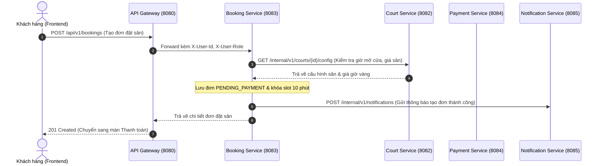
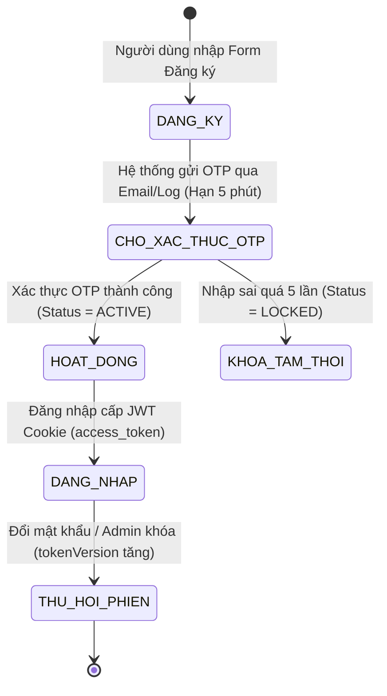
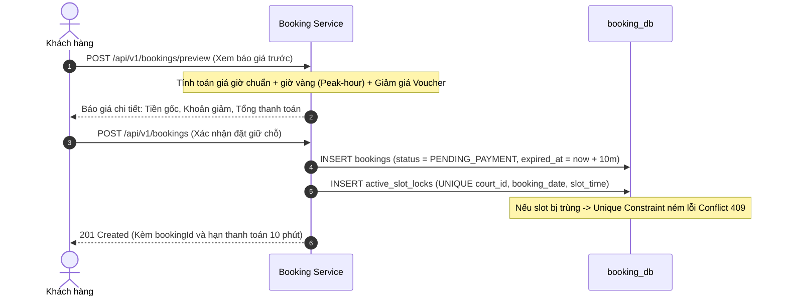
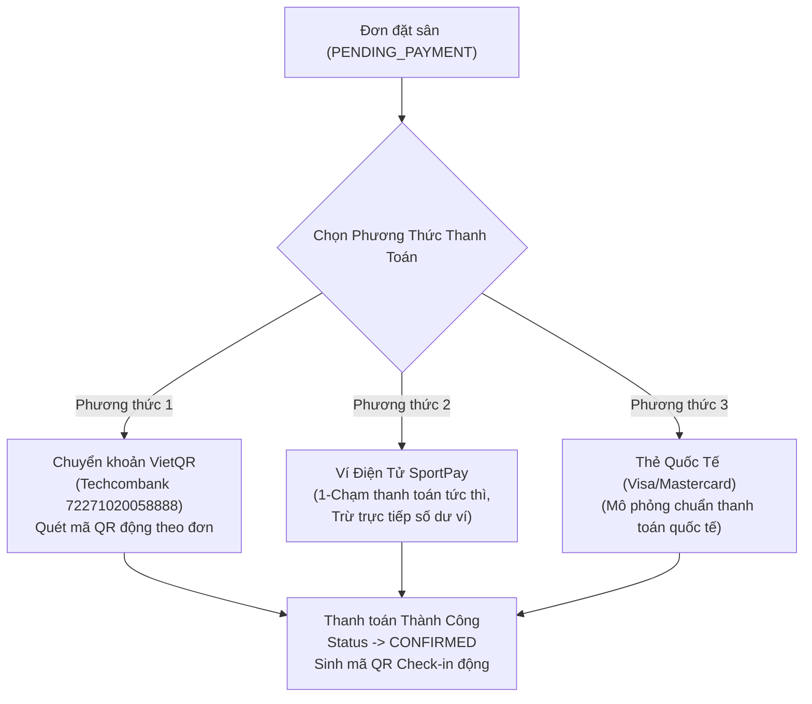
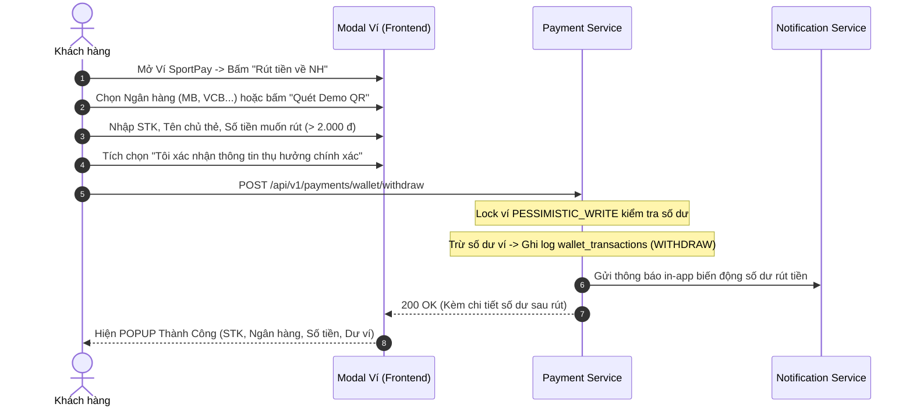
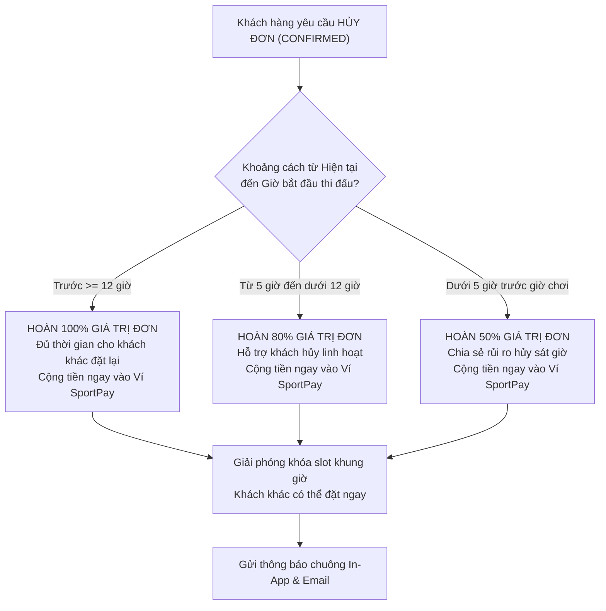
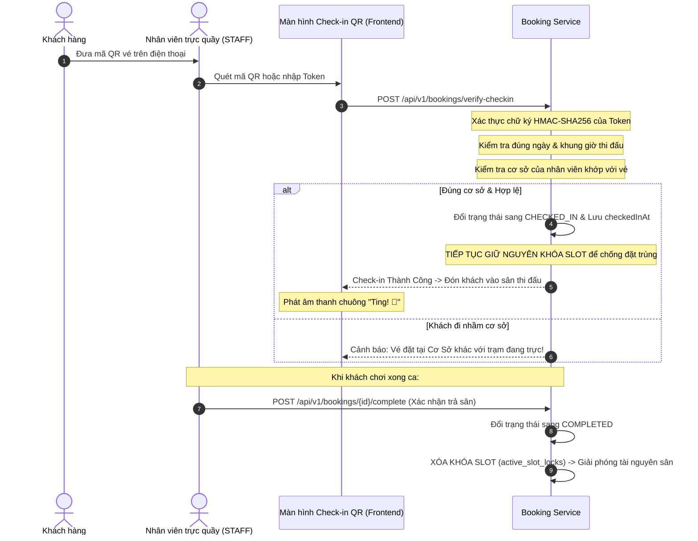

# ESportKing — Kiến Trúc Kỹ Thuật & Đặc Tả Nghiệp Vụ Toàn Diện
> **Tài liệu Kỹ thuật Chuyên sâu dành cho Báo cáo Đồ án Kiến trúc Hướng Dịch vụ (SOA)**  
> **Hệ thống:** ESportKing Smart Sport Booking Platform (Hà Nội, Việt Nam)  
> **Cập nhật:** 25/11/2026 — Phiên bản 2.1: 6 Microservices, Redis Token Cache, RabbitMQ Async Messaging, Trợ lý AI 2-trong-1, Dịch vụ phục vụ tại sân, Ví điện tử SportPay & Check-in QR động.

---

## MỤC LỤC
1. [Phân Tích Kiến Trúc 6 Microservices & Lý Do Không Tách Nhỏ](#1-phân-tích-kiến-trúc-6-microservices--lý-do-không-tách-nhỏ)
2. [Sơ Đồ Móc Nối Liên Dịch Vụ & Cơ Chế Bảo Mật Gateway](#2-sơ-đồ-móc-nối-liên-dịch-vụ--cơ-chế-bảo-mật-gateway)
3. [Luồng Nghiệp Vụ 1: Xác Thực, Phân Quyền & Quản Lý Phiên](#3-luồng-nghiệp-vụ-1-xác-thực-phân-quyền--quản-lý-phiên)
4. [Luồng Nghiệp Vụ 2: Danh Mục 30 Sân & Lưới Khung Giờ Khả Dụng](#4-luồng-nghiệp-vụ-2-danh-mục-30-sân--lưới-khung-giờ-khả-dụng)
5. [Luồng Nghiệp Vụ 3: Đặt Sân, Khóa Slot Tạm Thời & Báo Giá Real-Time](#5-luồng-nghiệp-vụ-3-đặt-sân-khóa-slot-tạm-thời--báo-giá-real-time)
6. [Luồng Nghiệp Vụ 4: Đa Phương Thức Thanh Toán (VietQR, Visa, Ví SportPay)](#6-luồng-nghiệp-vụ-4-đa-phương-thức-thanh-toán-vietqr-visa-ví-sportpay)
7. [Luồng Nghiệp Vụ 5: Ví Điện Tử SportPay & Rút Tiền Demo Về Ngân Hàng](#7-luồng-nghiệp-vụ-5-ví-điện-tử-sportpay--rút-tiền-demo-về-ngân-hàng)
8. [Luồng Nghiệp Vụ 6: Chính Sách Hủy Đơn & Hoàn Tiền Chuẩn Hóa Thực Tế (100% / 50% / 0%)](#8-luồng-nghiệp-vụ-6-chính-sách-hủy-đơn--hoàn-tiền-chuẩn-hóa-thực-tế-100--50--0)
9. [Luồng Nghiệp Vụ 7: Hệ Thống Kho Voucher & Tự Động Chọn Mã Giảm Giá Tốt Nhất](#9-luồng-nghiệp-vụ-7-hệ-thống-kho-voucher--tự-động-chọn-mã-giảm-giá-tốt-nhất)
10. [Luồng Nghiệp Vụ 8: Trạm Check-in Trực Ban & Vận Hành Ca Thi Đấu](#10-luồng-nghiệp-vụ-8-trạm-check-in-trực-ban--vận-hành-ca-thi-đấu)
11. [Luồng Nghiệp Vụ 9: Hệ Thống Chuông Thông Báo In-App & Hàng Đợi RabbitMQ](#11-luồng-nghiệp-vụ-9-hệ-thống-chuông-thông-báo-in-app--hàng-đợi-rabbitmq)
12. [Luồng Nghiệp Vụ 10: Trợ Lý AI 2-Trong-1 (Gemini API) & Phục Vụ Tại Sân](#12-luồng-nghiệp-vụ-10-trợ-lý-ai-2-trong-1-gemini-api--phục-vụ-tại-sân)

---

## 1. Phân Tích Kiến Trúc 6 Microservices & Lý Do Không Tách Nhỏ

Hệ thống được tổ chức thành **6 microservices độc lập**, áp dụng mô hình **Database-per-Service** (mỗi service nghiệp vụ sở hữu cơ sở dữ liệu riêng, không truy cập chéo DB của nhau):

```mermaid
flowchart TD
    UserClient["Web Browser (React 18 + Vite)"] -->|HTTP / REST (Port 8080)| Gateway["1. API Gateway (Port 8080)<br/><i>JWT Decode, CSRF Filter, Redis Cache</i>"]
    
    Gateway -->|Token Revocation Cache| Redis[("Redis 7 (Port 6379)")]
    Gateway -->|HTTP Route /users| US["2. User Service (Port 8081)<br/><b>user_db</b>"]
    Gateway -->|HTTP Route /courts| CS["3. Court Service (Port 8082)<br/><b>court_db</b>"]
    Gateway -->|HTTP Route /bookings & /ai| BS["4. Booking Service (Port 8083)<br/><b>booking_db</b>"]
    Gateway -->|HTTP Route /payments| PS["5. Payment Service (Port 8084)<br/><b>payment_db</b>"]
    Gateway -->|HTTP Route /notifications| NS["6. Notification Service (Port 8085)<br/><b>notification_db</b>"]
    
    US -.->|Sync tokenVersion| Redis
    BS -->|Async Events| MQ[("RabbitMQ 3.13 (Port 5672)")]
    PS -->|Async Events| MQ
    MQ -->|Consume Queue| NS
```

### Tại sao KHÔNG tách nhỏ hơn thành 7–8 service?
1. **Nguyên tắc Phân định Ranh giới Nghiệp vụ (Bounded Context - DDD):**  
   6 dịch vụ này đại diện cho 6 miền nghiệp vụ cốt lõi và khép kín:
   * Quản lý định danh cá nhân $\rightarrow$ `user-service`.
   * Quản lý cơ sở vật chất sân bãi $\rightarrow$ `court-service`.
   * Quản lý lịch trình, khóa slot và tạo đơn $\rightarrow$ `booking-service`.
   * Quản lý dòng tiền, cổng giao dịch và số dư ví $\rightarrow$ `payment-service`.
   * Giao tiếp truyền thông người dùng $\rightarrow$ `notification-service`.
   * Kiểm soát an ninh và lưu lượng $\rightarrow$ `api-gateway`.
2. **Tránh bẫy "Distributed Monolith" & Rủi ro Giao dịch phân tán (2PC / Distributed Transactions):**  
   Nếu bóc tách Ví điện tử thành `wallet-service` riêng, luồng hủy vé sẽ tạo thành chuỗi 4 bước gọi mạng liên tiếp: `Booking -> Payment -> Wallet -> Notification`. Khi mạng chập chờn, việc rollback phân tán cực kỳ phức tạp. Việc đưa Ví (`wallets` & `wallet_transactions`) vào `payment-service` đảm bảo giao dịch dòng tiền (Payment $\leftrightarrow$ Refund $\leftrightarrow$ Wallet) nằm trong cùng một Database Schema, đảm bảo tính nguyên tử ACID tuyệt đối.
3. **Giới hạn tài nguyên thực tế:**  
   6 instance Spring Boot 3 + Java 21 ngốn ~3.5GB RAM trên máy cá nhân. Quy mô này là điểm cân bằng hoàn hảo giữa tính mô hình hóa chuyên ngành và tính khả thi khi demo trực tiếp trước hội đồng.

---

## 2. Sơ Đồ Móc Nối Liên Dịch Vụ & Cơ Chế Bảo Mật Gateway

### 2.1. Ma trận Giao tiếp giữa các Dịch vụ (Service Interaction Matrix)

Các dịch vụ giao tiếp với nhau qua giao thức REST HTTP nội bộ (sử dụng Spring `RestClient` non-blocking và có timeout giới hạn):



### 2.2. Cơ chế Bảo mật tại API Gateway
1. **Lọc sạch Header giả mạo (Header Stripping):**  
   Client bên ngoài tuyệt đối không thể tự chèn các header như `X-User-Id`, `X-User-Role`, `X-Gateway-Token`. Bộ lọc `BoLocBaoMatVaCsrf.java` tại Gateway tự động xóa bỏ toàn bộ các header này trước khi xử lý request.
2. **Giải mã Token từ Cookie HttpOnly (Không lưu LocalStorage):**  
   Gateway đọc cookie `access_token`, kiểm tra tính toàn vẹn chữ ký HMAC-SHA256, giải mã `userId`, `email`, `role`, `tokenVersion`. Sau đó, Gateway gọi kiểm tra nhanh thu hồi phiên (Token Revocation) non-blocking với `user-service`. Nếu phiên hợp lệ, Gateway mới inject header `X-User-Id` và `X-User-Role` chuyển xuống backend.
3. **Phòng chống tấn công CSRF (Double Submit Cookie Pattern):**  
   Với mọi request làm thay đổi dữ liệu (`POST`, `PUT`, `PATCH`, `DELETE`), Gateway yêu cầu cả Cookie `XSRF-TOKEN` và Header `X-CSRF-Token` phải tồn tại và khớp nhau 100%.
4. **Xác thực API Nội bộ (`X-Internal-Api-Key`):**  
   Tất cả các route `/internal/v1/**` giữa các microservice chỉ chấp nhận request mang header `X-Internal-Api-Key` trùng khớp với cấu hình hệ thống. Người dùng từ Internet gọi vào `/internal/**` sẽ bị Gateway chặn ngay lập tức với mã lỗi `403 FORBIDDEN`.

---

## 3. Luồng Nghiệp Vụ 1: Xác Thực, Phân Quyền & Quản Lý Phiên



* **Xác thực OTP chuẩn:** Mã OTP 6 chữ số có thời hạn 5 phút, giới hạn gửi lại (cooldown 60 giây) và giới hạn tối đa 5 lần thử. Khi chưa cấu hình SMTP máy chủ, OTP được ghi nhận an toàn vào log hệ thống để phục vụ thử nghiệm.
* **4 Cấp Phân Quyền Hệ Thống:**
  1. `CUSTOMER`: Xem sân, đặt sân, thanh toán, quản lý vé của mình, sử dụng Ví SportPay.
  2. `STAFF`: Nhân viên trực quầy tại 3 cơ sở Hà Nội, chuyên trách màn hình Check-in QR và đối soát vé vào sân.
  3. `OWNER`: Chủ cụm sân, xem báo cáo doanh thu và tình trạng các sân thuộc quyền quản lý.
  4. `ADMIN`: Toàn quyền hệ thống, thống kê doanh thu đa cơ sở, khóa/mở tài khoản, duyệt sân bãi.

---

## 4. Luồng Nghiệp Vụ 2: Danh Mục 30 Sân & Lưới Khung Giờ Khả Dụng

Hệ thống chuẩn hóa danh mục **30 sân thể thao vật lý thực tế** phân bổ đều tại 3 cơ sở trọng điểm ở Hà Nội:
* **Cơ Sở 1 (Cầu Giấy):** Số 18 Duy Tân — 10 sân (Bóng đá, Cầu lông, Bóng rổ, Tennis).
* **Cơ Sở 2 (Đống Đa):** Số 102 Trường Chinh — 10 sân.
* **Cơ Sở 3 (Hà Đông):** Số 27 Quang Trung — 10 sân.

### Lưới Khung Giờ 30 Phút (30-Minute Time Grid):
* Thời gian trong ngày từ 06:00 đến 23:00 được chia thành các khối (block) cố định 30 phút (VD: `06:00-06:30`, `06:30-07:00`, ...).
* Một ca đặt sân có thời lượng tối thiểu 60 phút, tối đa 240 phút và phải là bội số của 30 phút (60p, 90p, 120p, 150p...).
* **Kiểm tra khả dụng thời gian thực (`POST /availability`):**  
  Truy vấn đồng thời bảng `booking_slots` (các slot của đơn đã `CONFIRMED` hoặc `CHECKED_IN`) và bảng `active_slot_locks` (các slot đang bị giữ chỗ thanh toán trong 10 phút) để loại trừ khung giờ bị trùng, trả về danh sách block thực sự trống cho khách hàng.

---

## 5. Luồng Nghiệp Vụ 3: Đặt Sân, Khóa Slot Tạm Thời & Báo Giá Real-Time



* **Chống Đặt Trùng Tuyệt Đối (Zero Overlapping Guarantee):**  
  Khóa duy nhất cấp cơ sở dữ liệu `UNIQUE KEY uk_court_date_slot (court_id, booking_date, slot_time)` trong bảng `active_slot_locks` đảm bảo ngay cả khi 100 khách hàng cùng bấm đặt 1 sân tại cùng 1 giây, chỉ có duy nhất 1 khách hàng giữ slot thành công; 99 yêu cầu còn lại nhận thông báo sân đã có người giữ chỗ.

---

## 6. Luồng Nghiệp Vụ 4: Đa Phương Thức Thanh Toán (VietQR, Visa, Ví SportPay)

Giao diện thanh toán hiện đại tại `TrangThanhToan.jsx` hỗ trợ **3 phương thức thanh toán song song**:



1. **Phương thức 1: Chuyển khoản VietQR:**  
   Backend sinh chuỗi mã chuẩn EMVCo và hình ảnh QR VietQR Techcombank kèm số tiền và nội dung chuyển khoản định danh (`BOOKING_{id}`).
2. **Phương thức 2: Ví Điện Tử SportPay (Nhanh nhất):**  
   Thanh toán tức thì trong 1 giây không cần mở ứng dụng ngân hàng. Hệ thống kiểm tra số dư ví $\ge$ giá trị đơn, trừ tiền và chuyển trạng thái đơn sang `CONFIRMED` ngay lập tức.
3. **Phương thức 3: Thẻ Quốc Tế Visa/Mastercard:**  
   Form nhập thẻ chuẩn quốc tế (Số thẻ 16 số, Ngày hết hạn MM/YY, Mã bảo mật CVV).

---

## 7. Luồng Nghiệp Vụ 5: Ví Điện Tử SportPay & Rút Tiền Demo Về Ngân Hàng

Ví SportPay là giải pháp dòng tiền nội bộ khép kín giúp nâng cao trải nghiệm khách hàng và giải quyết triệt để bài toán hoàn tiền trong kiến trúc vi dịch vụ:



### Các ràng buộc nghiệp vụ (Business Rules) của Ví:
* **Khởi tạo số dư:** Mỗi tài khoản khách hàng mới được khởi tạo số dư trải nghiệm **1.000.000 VNĐ**.
* **Ràng buộc rút tiền:**
  * Số tiền rút bắt buộc phải $> 2.000$ VNĐ.
  * Số tiền rút không được vượt quá số dư khả dụng hiện có.
  * Hỗ trợ nút rút nhanh toàn bộ số dư.
  * Phải có sự đồng thuận qua checkbox xác nhận trách nhiệm thông tin tài khoản.
* **Ghi vết lịch sử (Audit Trail):** Mọi giao dịch `TOP_UP`, `PAYMENT`, `REFUND`, `WITHDRAW` đều lưu rõ `balance_before` và `balance_after` để đối soát minh bạch 100%.

---

## 8. Luồng Nghiệp Vụ 6: Chính Sách Hủy Đơn & Hoàn Tiền Chuẩn Hóa (100% / 80% / 50%)

Chính sách hoàn tiền được xây dựng theo chuẩn mực linh hoạt (Time-window Policy), phân bổ rủi ro công bằng giữa khách hàng và nhà vận hành cụm sân:



### Đặc điểm nổi bật:
* **Tính toán minh bạch trên giao diện:** Trước khi khách bấm xác nhận hủy tại `TrangVeCuaToi.jsx`, hệ thống tự tính khoảng cách thời gian và thông báo rõ:
  * Trước $\ge 12$h: Hoàn **100%** vào Ví SportPay.
  * Từ 5h đến dưới 12h: Hoàn **80%** vào Ví SportPay.
  * Dưới 5h trước giờ chơi: Hoàn **50%** vào Ví SportPay.
* **Hoàn tiền trong 1 giây:** Tiền hoàn nạp trực tiếp vào Ví SportPay, dùng để thanh toán các đơn tiếp theo hoặc có thể rút về tài khoản ngân hàng bất kỳ lúc nào.

---

## 9. Luồng Nghiệp Vụ 7: Hệ Thống Kho Voucher & Tự Động Chọn Mã Giảm Giá Tốt Nhất

Hệ thống cung cấp danh mục 8 voucher toàn diện, đồng bộ từ Database MySQL `booking_db.vouchers` tới Frontend:
1. `CHAOBANMOI`: Giảm 20% (tối đa 50k), đơn từ 100k (Dành cho thành viên mới).
2. `THELUC2026`: Giảm 15% (tối đa 40k), đơn từ 100k (Khỏe đẹp mỗi ngày).
3. `CUOITUAN`: Giảm 15% (tối đa 80k), đơn từ 150k (Cuối tuần bùng nổ).
4. `CUOITUANXU`: Giảm ngay 25k, đơn từ 150k.
5. `VIPSPORT`: Giảm ngay 30k, đơn từ 200k (Khách hàng thân thiết).
6. `PICKLE50`: Giảm 10% (tối đa 35k), đơn từ 100k (Đại tiệc vợt).
7. `TRIAN2026`: Giảm ngay 20k, đơn từ 100k (Tri ân khách hàng).
8. `THETHAO50`: Giảm ngay 50k, đơn từ 200k (Tiết kiệm tối đa).

### Thuật toán Tự Động Áp Dụng Mã Tốt Nhất (Smart Auto-Select):
* Khi khách hàng chọn sân, ngày và khung giờ tại `TrangChiTietSan.jsx`, hệ thống tự tính `tongTienSan`.
* Thuật toán kiểm tra điều kiện `minOrderAmount` và tính toán số tiền thực tế được giảm cho từng voucher khả dụng.
* Voucher đem lại số tiền tiết kiệm lớn nhất được tự động chọn sẵn và gán nhãn `⭐ Tốt nhất` cùng thông báo: `✨ Hệ thống đã tự động áp dụng mã giảm giá tốt nhất: [MÃ] (-XX.000 đ)`.
* Khách hàng vẫn có quyền chuyển đổi voucher tùy ý hoặc bấm nút "Dùng mã tốt nhất" bất kỳ lúc nào.
* Tại `TrangHoSoCaNhan.jsx` (tab Kho Voucher): Hiển thị đầy đủ nhãn `✓ ĐÃ LƯU TRONG VÍ` cho các mã khách đã lưu từ Trang Chủ, đồng thời sửa triệt để lỗi hiển thị "Giảm 0%" của voucher giảm số tiền cố định.

---

## 10. Luồng Nghiệp Vụ 8: Trạm Check-in Trực Ban & Vận Hành Ca Thi Đấu



* **Giữ Slot Lock trong suốt ca thi đấu:** Khác với các hệ thống thông thường giải phóng slot ngay khi check-in, ESportKing giữ nguyên khóa slot trong suốt quá trình khách chơi (`CHECKED_IN`) và chỉ giải phóng khi nhân viên xác nhận trả sân (`COMPLETED`), ngăn chặn tuyệt đối tình trạng khách lạ đặt đè lên sân đang có người thi đấu.

---

## 11. Luồng Nghiệp Vụ 9: Hệ Thống Chuông Thông Báo In-App & Hàng Đợi RabbitMQ

* **Giao tiếp Bất đồng bộ qua RabbitMQ (Event-Driven Architecture):**  
  Khi phát sinh sự kiện nghiệp vụ (`Tạo đơn`, `Thanh toán`, `Hủy hoàn tiền`, `Rút tiền ví`, `Check-in thành công`, `Yêu cầu phục vụ tại sân`), `booking-service` và `payment-service` đẩy message JSON vào hàng đợi **RabbitMQ**. `notification-service` (`NguoiLangNgheThongBao.java`) lắng nghe bất đồng bộ để ghi vào `notification_db` (có cơ chế chống trùng theo `event_id` và tự động fallback gọi REST nội bộ nếu chạy local không bật RabbitMQ).
* **Sửa dứt điểm lỗi `isRead` vs `read`:**  
  DTO `TraVeThongBao.java` xuất bản song song cả `@JsonProperty("isRead")` và `@JsonProperty("read")`. Phía Frontend kiểm tra `n.isRead !== undefined ? !n.isRead : !n.read`, đảm bảo thông báo đã đọc sẽ không bị sáng đỏ lại khi tải lại trang hoặc mở trình duyệt mới.
* **Đọc tất cả 1-Chạm:**  
  Nút "Đọc Tất Cả" gọi trực tiếp API `PATCH /notifications/read-all`, thực thi câu lệnh SQL tối ưu cập nhật toàn bộ thông báo chưa đọc của user sang `is_read = true` trong database.
* **Bộ lọc Tab & Gắn nhãn Cơ sở:**  
  * **Tất cả:** Toàn bộ thông báo.
  * **Lịch đặt sân:** Gom nhóm các sự kiện `BOOKING_CREATED`, `PAYMENT_SUCCESS`, `BOOKING_REFUNDED`, `CHECKIN_SUCCESS`, `BOOKING_COMPLETED`, `SERVICE_REQUEST` (kèm nhãn cơ sở Cầu Giấy / Đống Đa / Hà Đông cho Staff/Admin).
  * **Ưu đãi:** Thông báo khuyến mãi voucher giờ vàng.

---

## 12. Luồng Nghiệp Vụ 10: Trợ Lý AI 2-Trong-1 (Gemini API) & Phục Vụ Tại Sân

### 12.1. Trợ Lý AI ESportKing (`DichVuTroLyAi.java` & `NutGoiDichVuFAB.jsx`)
* **Kiến trúc Hybrid (FAQ Tức thì + Gemini LLM):**
  * Các câu hỏi thường gặp về giá sân, giờ mở cửa, chính sách hủy/hoàn tiền, địa chỉ 3 cơ sở được giải đáp tức thì ở phía Client (0ms, không tốn quota API).
  * Các câu hỏi tư vấn tự do được gửi qua `POST /api/v1/bookings/ai/chat` tới `booking-service`, sử dụng mô hình **Gemini** (model chính `gemini-3.8-flash`, tự động fallback sang `gemini-3.6-flash` khi quá tải).
* **Bảo mật AI (Guardrails & Output Filtering):**
  * Chặn các mẫu tấn công **Prompt Injection / SQL Injection** trước khi gửi lên LLM.
  * Bộ lọc đầu ra tự động che giấu (mask) các chuỗi có dạng khóa bí mật/API key (`AIza...`, `AQ....`) nếu vô tình xuất hiện.
* **Giao diện Widget 2-trong-1:** Nút tròn linh vật mèo (`ai-mascot.webp`, 72×72px) có thể kéo thả (draggable) và thu gọn/đóng linh hoạt.

### 12.2. Yêu Cầu Phục Vụ Tại Sân (`DieuKhienYeuCauDichVu.java`)
* Khách đang trong ca thi đấu có thể gọi nước uống, cầu/bóng, thuê vợt hoặc hỗ trợ kỹ thuật ngay từ Widget nổi hoặc màn `TrangVeCuaToi.jsx`.
* Yêu cầu được lưu bền vững vào bảng `service_requests` (`V5__add_service_requests_table.sql`), bắn thông báo trực tiếp tới nhân viên trực ban đúng cơ sở (`STAFF`) và Quản trị viên (`ADMIN`), đồng thời hiển thị trong tab **Yêu cầu phục vụ tại sân** tại `/checkin` để nhân viên xác nhận hoàn tất.
